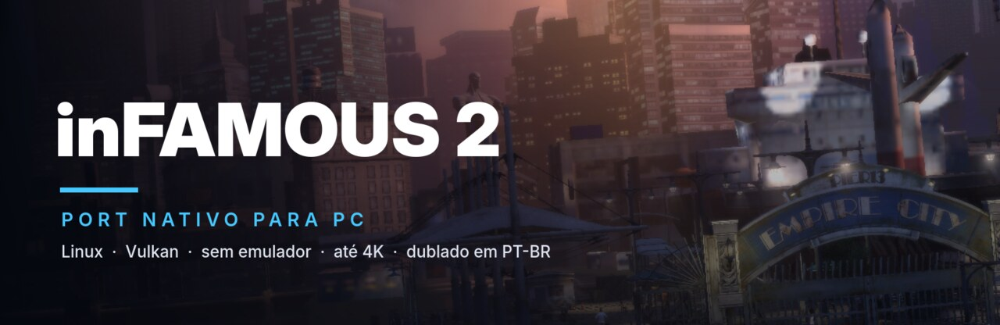
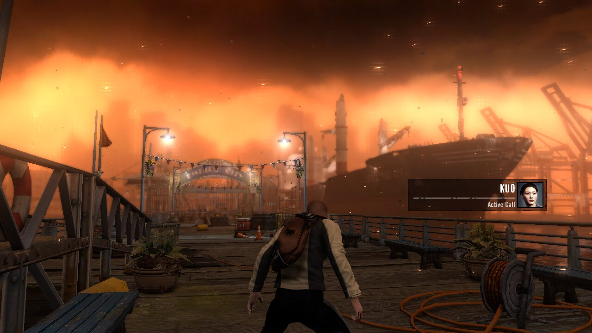
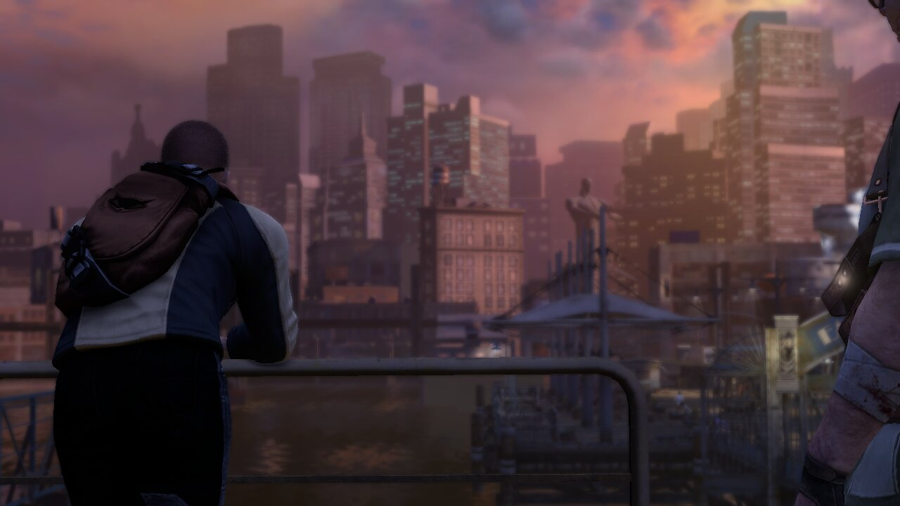
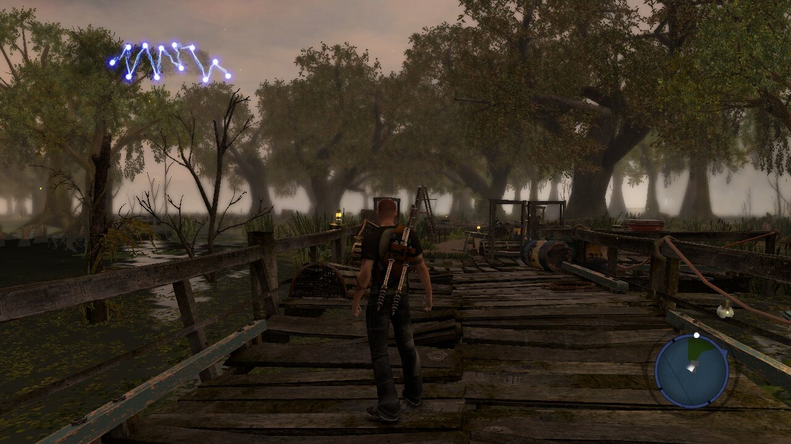
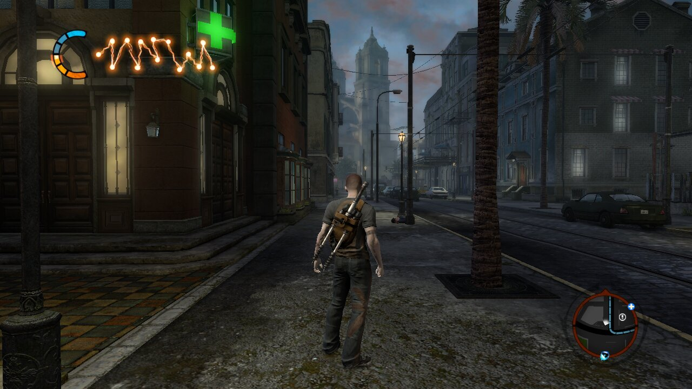
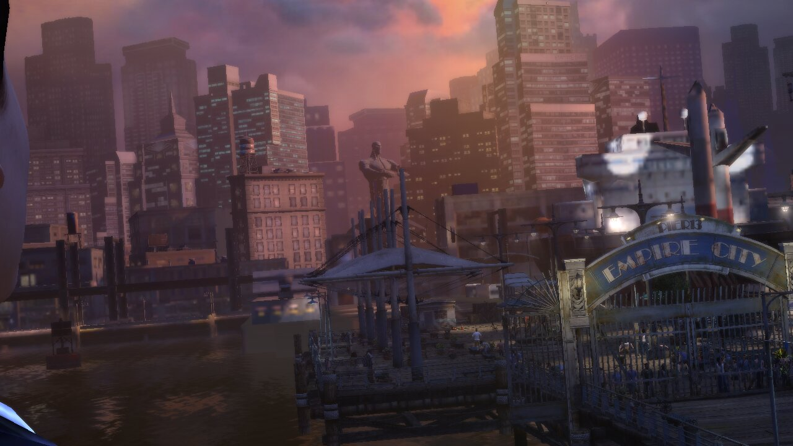

<p align="center"></p>

<h1 align="center">inFAMOUS 2 — port nativo para PC (Linux, Vulkan)</h1>

<p align="center">
  
  
  
  
  
  
  
</p>

<p align="center"><b>inFAMOUS 2 PC port</b> · native on Linux · PS3 static recompilation · Vulkan · up to 4K · unlocked frame rate · Brazilian Portuguese dub</p>

<p align="center">
  <a href="#english"><b>English below</b></a> ·
  <a href="docs/ARQUIVOS_NECESSARIOS.md">Arquivos necessários</a> ·
  <a href="docs/ROADMAP.md">Roadmap</a> ·
  <a href="docs/NOTES.md">Notas técnicas</a>
</p>

> **Jogável, em desenvolvimento.** O jogo inicia, passa pelos vídeos, menus e
> cutscenes, e o gameplay segue de Empire City até New Marais, com som,
> controle, saves e dublagem em português. O desempenho varia de ~54 fps nas
> ruas mais pesadas a ~130 fps no píer. Veja o [Status](#status).

**inFAMOUS 2** (PS3, BCUS98125, versão 01.00) rodando nativo no Linux, sem
emulador. O código do jogo, PowerPC (PPU) e SPU, é traduzido para C antes da
compilação por recompilação estática com o
[ps3recomp](https://github.com/sp00nznet/ps3recomp). O sistema do PS3 é
reimplementado, e a GPU (RSX) roda os shaders do próprio jogo traduzidos para
Vulkan.

> **Nenhum arquivo do jogo vem com este projeto.** Para jogar, você precisa da
> sua própria cópia, tirada do seu PS3. O build transforma o **seu** executável
> em código na **sua** máquina, e esse código não pode ser distribuído.

| | |
|---|---|
|  |  |
|  |  |



<sub>Capturas direto da GPU no Linux, com uma Radeon RX 9070 XT, em 1280×720.
As de Empire City foram renderizadas em 2× (2560×1440) e reduzidas.</sub>

## Novidades

- **Menu principal:** Continuar, Novo jogo, Carregar jogo, Opções e Sair, sobre
  a arte do disco. O inFAMOUS 2 não tem menu próprio (com save ele entra direto
  no autosave); o do port faz esse papel e copia os saves para `user/backups`
  antes de um jogo novo ou de carregar outro save.
- **Opções e menu no jogo:**
  - Vídeo, Idioma, Desempenho e Controle e saves, gravados em
    `user/settings.ini`.
  - No meio do jogo, **F1** (ou **Select+Start** segurados) abre as opções.
  - Funciona com mouse, teclado e controle.
  - Dublagem e legenda podem ser de idiomas diferentes.
- **SPUs mais rápidos:**
  - Contas de float com expoente 255 resolvidas no vetor.
  - Sem barreira de memória antes de cada DMA.
  - Sem checagens de debug no código traduzido.
  - Nas ruas pesadas: de 54,9 para 56,9 fps.
- **Engasgo ao virar a câmera: corrigido.**
  - Cada textura que o jogo descartava fazia o port parar e esperar a GPU
    inteira. Girando a câmera numa área nova, eram ~5.800 esperas por
    segundo, metade do tempo parado, e o fps caía para 9–12.
  - Agora o objeto é destruído quando o frame que o usa termina: as esperas
    sumiram e o fps fica em 39–50 durante o giro.
- **Thread de gravação Vulkan:**
  - As chamadas ao Vulkan rodam numa thread própria, ao lado da que decide
    cada draw (`PS3RECOMP_BE_THREAD`, ligada no `play.sh`).
  - +12% nas ruas mais pesadas (~9.100 draws por frame): de 47,7 para
    53,6 fps.
- **Geometria residente na VRAM:**
  - A geometria que não mudou fica na placa de vídeo, em vez de ser copiada
    a cada draw.
  - Textura que não mudou não é decodificada de novo.
  - New Marais: de 89,9 para 95 fps.
- **Dublagem e textos em português (PT-BR).** O jogo escolhe o idioma pelo
  idioma do sistema, e o port agora o informa. Detalhe: o PT-BR do jogo vem
  pelo idioma "Português" (`PS3_SYS_LANG=pt`, já o padrão do `play.sh`). Veja
  [Idioma](#idioma).
- **Tela cheia sem esticar:**
  - **F11** ou **Alt+Enter** alternam a tela cheia.
  - Em monitor ultrawide (21:9) ou 16:10, a imagem 16:9 fica com barras
    pretas em vez de esticada.
- **Água corrigida:** era preta, porque o shader da água usava correção de
  perspectiva e o tradutor de shaders a ignorava.
- **Saves funcionando:** Salvar, Continuar e o autosave.

## Status

| Área | Estado |
|---|---|
| Boot, vídeos, menus e cutscenes | ✅ Funciona |
| Gameplay | ✅ De Empire City até New Marais, com poderes, escalada e missões do começo do jogo |
| Áudio (Wwise no SPU) | ✅ Funciona |
| Saves | ✅ Salvar, Continuar e autosave |
| Controle | ✅ Xbox, DualShock 4 e DualSense via SDL2 |
| Dublagem e textos em português | ✅ `PS3_SYS_LANG=pt` (padrão) |
| Resolução acima de 720p | ✅ Escala 2× (1440p) e 3× (4K) |
| Desempenho | 🔧 54–130 fps conforme a área (veja a tabela abaixo); a meta é 120+ em todo lugar |
| Engasgos | 🔧 O do giro de câmera foi corrigido; ainda há um pico na primeira vez que cada shader é compilado |
| Travamentos | 🔧 Raros, no meio do jogo; o `play.sh` grava o estado das threads quando acontece (veja [Logs](#logs-e-relatórios)) |
| Imagem | 🔧 Correta na maior parte; falhas pontuais ainda aparecem |
| Linux | ✅ Testado no Fedora 44 |
| Windows | ❌ Ainda não: o backend Vulkan é só para Linux |

### Desempenho

Ryzen 7 9800X3D + Radeon RX 9070 XT, resolução nativa (1280×720):

| Cena | FPS |
|---|---|
| Menu 3D | ~115 |
| Píer de Empire City (tutorial, andando) | ~120–130 |
| Pântano de New Marais | ~100 |
| Ruas mais pesadas (~9.100 draws por frame) | ~54 |

Em 4K (`PS3RECOMP_RES_SCALE=3`) o pântano de New Marais roda no mesmo fps que
em 720p: quem limita é a CPU, não a GPU. Os detalhes de onde vai o tempo de
cada frame estão em [docs/NOTES.md](docs/NOTES.md).

### PS3 × este port

| | PS3 | Este port |
|---|---|---|
| Resolução | 1280×720 | 1280×720, 2560×1440 ou 3840×2160 |
| Taxa de quadros | alvo de 30 fps | 54–130 fps (sem trava) |
| Monitor ultrawide | — | imagem 16:9 com barras, sem esticar |
| Execução | Cell (PPU + SPUs) e RSX | código traduzido para x86-64, GPU em Vulkan |

## Arquivos do jogo necessários

Tudo vem do **seu** PS3. Nada disso está no repositório.

- **O jogo:** disco do inFAMOUS 2, **BCUS98125 (EUA), versão 01.00**, em dump do seu disco. Serve de `PS3_GAME/` inteiro.
- **O código:** `PS3_GAME/USRDIR/EBOOT.elf`, que é o `EBOOT.BIN` do disco descriptografado (por exemplo no RPCS3). É o código que é traduzido.
- **O firmware:** o PUP oficial do PS3, instalado no RPCS3 (`dev_flash`). Serve para as leituras de `/dev_flash` do jogo.

O passo a passo está em [docs/ARQUIVOS_NECESSARIOS.md](docs/ARQUIVOS_NECESSARIOS.md). Para usar em um segundo PC, o `disc/` é copiado direto entre as máquinas (por exemplo com `rsync`): ele nunca vai para o git.

**PC:**

- Linux x86-64.
- CPU com AVX2. O código SPU usa AVX-512; para CPU sem ele, veja o
  documento acima.
- GPU com Vulkan.
- ~14 GB de RAM livres para compilar.
- ~3 GB de disco para o código traduzido, além do jogo.

## Como jogar

Não há binários para baixar: o código traduzido é o do jogo e só pode existir na
sua máquina. O caminho é compilar:

```sh
scripts/setup.sh    # ps3recomp na versão base + o patch deste port, venv Python
scripts/lift.sh     # traduz o PPU e os SPUs do SEU EBOOT.elf
scripts/build.sh    # compila em work/port/build-vk
work/play.sh        # janela + controle + som
```

A tradução leva alguns minutos; a primeira compilação é demorada, porque o
código traduzido do PPU é grande.

Ao abrir, aparece o **menu principal**, sobre a arte do próprio disco
(`PIC1.PNG`), e funciona com controle, teclado ou mouse:

| Item | O que faz |
|---|---|
| **Continuar** | entra no save mais recente (mostra nome, progresso e data) |
| **Novo jogo** | abre a tela de jogo novo do próprio inFAMOUS 2 |
| **Carregar jogo** | lista os seus saves; escolha um |
| **Opções** | as abas abaixo |
| **Sair** | fecha |

As opções ficam gravadas em `user/settings.ini`:

| Aba | O que tem |
|---|---|
| Vídeo | resolução (720p, 1440p, 4K), tela cheia, VSync, esticar ou barras, monitor |
| Idioma | dublagem e legendas, separadas |
| Desempenho | predefinições, limite de FPS, contador de FPS, thread de gravação |
| Controle e saves | controle detectado e teste de botões, pasta e backup dos saves, logs |

| Tecla | O que faz |
|---|---|
| **F1**, ou **Select+Start** segurados | abre e fecha o menu durante o jogo |
| **F11** ou **Alt+Enter** | tela cheia / janela |
| **Esc** | fecha o jogo |

- **Pular o menu:** `work/play.sh --play` ou `PS3_SKIP_LAUNCHER=1`; direto na tela
  de jogo novo: `work/play.sh --title`.
- **Por que o port tem menu:** o inFAMOUS 2 não tem menu principal. Com save, ele
  entra direto no autosave; sem save, mostra só "Começar um jogo novo". O menu do
  port faz esse papel sem mexer nos saves. Antes de **Novo jogo** ou de carregar
  um save que não é o autosave, eles são copiados para `user/backups`, porque o
  próximo autosave do jogo grava por cima do slot de autosave, como no console.
  Dentro do jogo: **Start → Dados salvos**.
- **Variáveis de ambiente:** continuam valendo e ganham do arquivo
  (`PS3RECOMP_RES_SCALE=2`, `PS3_VOICE_LANG=english`, `PS3RECOMP_VK_PRESENT=fifo`…).
  O `work/play.sh` documenta as outras.

## Perguntas frequentes

**Existe inFAMOUS 2 para PC?** Não oficialmente. Este projeto roda o jogo do PS3 nativo no Linux, sem emulador, por recompilação estática.

**Dá para jogar inFAMOUS 2 no PC sem RPCS3?** Sim, é o que este port faz, com a sua própria cópia do jogo. Os arquivos necessários estão em [docs/ARQUIVOS_NECESSARIOS.md](docs/ARQUIVOS_NECESSARIOS.md).

**Roda no Windows?** Há um pacote em teste. Veja o [Status](#status).

**O jogo vem junto?** Não. Nenhum arquivo do jogo faz parte do projeto.

## Idioma

O disco traz voz e texto de todas as regiões (`brazilian.psarc`,
`brazilian_text.psarc`, `latino.psarc`…), e o jogo escolhe pelo idioma do
console:

- O jogo foi feito antes de o PS3 ter "Português (Brasil)" (número 17), então
  trata esse número como desconhecido e cai no inglês.
- O caminho para o PT-BR é o idioma "Português" (7), que a lista da região
  norte-americana liga aos arquivos `brazilian`.
- O port escolhe esse número sozinho a partir do idioma das legendas, e serve
  os arquivos de voz e de texto que você escolheu na aba Idioma.

## Saves e dados

- Os saves ficam em `gamedata/dev_hdd0/home/00000001/savedata/`.
- `PS3_SAVEDATA_ROOT=<pasta>` usa outra pasta. Os testes e benchmarks usam
  isso para nunca tocar nos saves de quem joga.

## Logs e relatórios

Cada sessão do `work/play.sh` grava `work/runs/play-<data>.log`. Duas capturas
são automáticas:

- **Travou:** depois de 15 s sem nenhum frame, ele grava a pilha de todas as
  threads e um perf de 5 s ao lado do log. Se o jogo travar, espere uns 20 s
  antes de fechar.
- **Ficou lento:** depois de 30 s abaixo de 70 fps, ele grava um perfil de 20 s
  (até três por sessão).

## Problemas conhecidos

- **Travamentos raros no meio do jogo:** a imagem para e o áudio continua. As
  capturas automáticas acima existem para achar a causa.
- **Primeira compilação de cada shader:** a primeira vez que um efeito aparece
  pode dar um pico de um frame. O cache em disco (`~/.cache/ps3recomp/spirv`)
  evita isso nas vezes seguintes.
- **Só Linux:** o backend Vulkan e a captura de stacks são Linux.

## Compilar do código-fonte

Veja [Como jogar](#como-jogar). Pacotes no Fedora (adapte para a sua distro):
`gcc gcc-c++ clang cmake ninja-build python3 SDL2-devel vulkan-headers
vulkan-loader-devel glslang-devel libpng-devel` (o libpng só desenha a arte do
disco no menu; sem ele, o fundo é liso).

| Caminho | O que é |
|---|---|
| `work/patches/ps3recomp.patch` | todas as mudanças no ps3recomp, sobre o upstream `42f5f8f` (MIT) |
| `work/port/` | o port: projeto CMake, `main.cpp`, as passadas de GPU que substituem jobs de SPU |
| `work/tools/lift_spu.py` | traduz todas as imagens SPU que o jogo roda |
| `work/tests/` | regressões de boot (`run_all.sh`) e o benchmark do píer |
| `scripts/` | setup, tradução, build e o `check_clean.sh` |
| `docs/NOTES.md` | notas de engenharia reversa: endereços, jobs de SPU, passadas de GPU, diagnósticos |
| `rpi/` | documentos de projeto das mudanças maiores |

O `.gitignore` é uma lista de permissões. O `scripts/install-hooks.sh` instala
hooks que rodam o `scripts/check_clean.sh` antes de cada commit e push. Ele
recusa:

- arquivos do jogo e de firmware;
- binários;
- código traduzido do jogo;
- qualquer coisa parecida com credencial.

## Como funciona

- **PPU:**
  - As ~39 mil funções do executável viram C (`ppu_lifter.py`).
  - O resultado é compilado com clang para x86-64-v3, com os acessos à memória
    do PS3 inline.
  - Os módulos do sistema são reimplementados (HLE).
- **SPU:** cada imagem SPU que o jogo roda é traduzida para C e compilada com
  SIMD do x86 (SSE4.1, AVX2, AVX-512):
  - o gerenciador de jobs;
  - os 27 módulos de job;
  - os plugins de oclusão;
  - as cadeias de job do Wwise;
  - o Bink e o zlib.
- **RSX:**
  - Um motor de desenho lê o banco de registradores do RSX e roda os vertex e
    fragment programs do próprio jogo, decompilados para HLSL e compilados
    para SPIR-V.
  - O backend Vulkan grava os comandos numa thread própria.
- **Passadas de GPU:** dois jobs de SPU, a oclusão ambiente (SSAO) e a
  iluminação deferida em tiles, rodam na GPU. Cada um foi conferido contra a
  saída do SPU.
- **Rastreamento de escrita:**
  - A memória local do RSX é vigiada por proteção de página.
  - Texturas e geometria que ninguém reescreveu não são decodificadas de
    novo.

Os detalhes, com endereços e medições, estão em [docs/NOTES.md](docs/NOTES.md).

## Próximos passos

Veja [docs/ROADMAP.md](docs/ROADMAP.md). A meta é **120+ fps em 4K com FSR**.
Antes disso vem:

- reduzir o custo por draw da thread do RSX;
- aliviar a vazão dos SPUs;
- achar a causa dos travamentos raros.

## Créditos e aviso legal

- **[ps3recomp](https://github.com/sp00nznet/ps3recomp)**, de sp00nznet e
  colaboradores (MIT): este port é o ps3recomp mais o
  `work/patches/ps3recomp.patch`.
- **[rpcs3-infamous2](https://github.com/ttmx/rpcs3-infamous2)**, de ttmx: a
  engenharia reversa dos jobs de oclusão e iluminação, que serviu de
  especificação para as passadas de GPU.
- **[RPCS3](https://rpcs3.net)**: referência de comportamento do RSX e do lv2,
  e a ferramenta usada para descriptografar o executável.
- Veja também [CREDITS.md](CREDITS.md). Feito com assistência de IA (Claude).

O código deste repositório é MIT ([LICENSE](LICENSE)). inFAMOUS 2 é
© Sony Interactive Entertainment / Sucker Punch Productions. Este projeto não é
afiliado a eles nem endossado por eles, e não contém nenhum arquivo do jogo.

---

<a id="english"></a>

# inFAMOUS 2 — native PC port

> **Playable, in development.** The game boots and plays its videos, menus and
> cutscenes. Gameplay runs from Empire City into New Marais, with sound,
> controller, saves and the Brazilian Portuguese dub. Performance ranges from
> ~54 fps in the heaviest streets to ~130 fps on the pier. See
> [Status](#status-1).

**inFAMOUS 2** (PS3, BCUS98125, version 01.00) running natively on Linux, with
no emulator:

- the game's PowerPC (PPU) and SPU code is translated to C ahead of time by
  static recompilation with [ps3recomp](https://github.com/sp00nznet/ps3recomp);
- the PS3 system is reimplemented;
- the RSX runs the game's own shaders, translated to Vulkan.

> **No game files come with this project.** You need your own copy, dumped
> from your own PS3. The build turns **your** executable into code on **your**
> machine, and that code must not be shared.

## What's new

- **Main menu:** Continue, New game, Load game, Options and Quit, over the
  disc's art. inFAMOUS 2 has no menu of its own (with a save it goes straight
  into the autosave); the port's stands in, and copies the saves to
  `user/backups` before a new game or loading another save.
- **Options and in-game menu:** Video, Language, Performance, Controller and
  saves, written to `user/settings.ini`; **F1** (or **Select+Start** held)
  opens them in game. Voices and subtitles can be different languages.
- **Faster SPUs:** extended-range floats stay in the vector, no fence before
  each DMA, no debug checks in the lifted code. Heaviest streets: 54.9 ->
  56.9 fps.
- **Stutter when turning the camera: fixed.**
  - Every texture the game let go made the port stop and wait for the whole
    GPU. Turning onto new ground that was ~5,800 waits a second, half the
    time, and the frame rate fell to 9–12.
  - Objects are now destroyed when the frame using them completes: the waits
    are gone and the turn holds 39–50 fps.
- **Vulkan recording thread:**
  - Vulkan calls run on their own thread, beside the one that works out each
    draw (`PS3RECOMP_BE_THREAD`, on in `play.sh`).
  - +12% in the heaviest streets (~9,100 draws a frame): 47.7 -> 53.6 fps.
- **Geometry kept in VRAM:**
  - Unchanged geometry stays on the GPU instead of being copied for every
    draw.
  - Unchanged texture units are not decoded again.
  - New Marais: 89.9 -> 95 fps.
- **Brazilian Portuguese dub and text.**
  - The game picks its language from the console's, which the port now
    reports.
  - The game reaches its PT-BR files through "Portuguese" (`PS3_SYS_LANG=pt`,
    the `play.sh` default). See [Language](#language).
- **Full screen without stretching:**
  - **F11** or **Alt+Enter** toggles it.
  - On a 21:9 or 16:10 screen the 16:9 picture gets black bars.
- **Water fixed:** it was black, because the water shader uses perspective
  correction, which the shader translator ignored.
- **Saves work:** save, continue and autosave.

## Status

| Area | State |
|---|---|
| Boot, videos, menus, cutscenes | ✅ Works |
| Gameplay | ✅ Empire City into New Marais, with powers, climbing and the early missions |
| Audio (Wwise on the SPU) | ✅ Works |
| Saves | ✅ Save, continue, autosave |
| Controller | ✅ Xbox, DualShock 4, DualSense through SDL2 |
| Brazilian Portuguese dub and text | ✅ `PS3_SYS_LANG=pt` (default) |
| Above 720p | ✅ 2× (1440p) and 3× (4K) resolution scale |
| Performance | 🔧 54–130 fps by area (table below); the goal is 120+ everywhere |
| Stutter | 🔧 The camera-turn stutter is fixed; the first build of each shader still spikes |
| Freezes | 🔧 Rare, mid-game; `play.sh` records every thread's stack when one happens |
| Image | 🔧 Mostly correct; a few glitches remain |
| Linux | ✅ Tested on Fedora 44 |
| Windows | ❌ Not yet: the Vulkan backend is Linux-only |

Ryzen 7 9800X3D + Radeon RX 9070 XT, native 1280×720:

| Scene | FPS |
|---|---|
| 3D main menu | ~115 |
| Empire City pier (tutorial, walking) | ~120–130 |
| New Marais swamp | ~100 |
| Heaviest streets (~9,100 draws a frame) | ~54 |

At 4K (`PS3RECOMP_RES_SCALE=3`), the New Marais swamp runs at the same frame
rate as at 720p: the CPU is the limit, not the GPU.

| | PS3 | This port |
|---|---|---|
| Resolution | 1280×720 | 1280×720, 2560×1440 or 3840×2160 |
| Frame rate | 30 fps target | 54–130 fps (uncapped) |
| Ultrawide monitor | — | 16:9 picture with bars, not stretched |
| Runs on | Cell (PPU + SPUs) and RSX | code translated to x86-64, GPU on Vulkan |

## Required game files

Everything comes from **your** PS3 (details in
[docs/ARQUIVOS_NECESSARIOS.md](docs/ARQUIVOS_NECESSARIOS.md)):

- **The disc.** inFAMOUS 2, **BCUS98125 (US), version 01.00**: the whole
  `PS3_GAME/`.
- **The executable.** `PS3_GAME/USRDIR/EBOOT.elf`, which is the disc's
  `EBOOT.BIN` decrypted (RPCS3 can do it).
- **The firmware.** The PS3 firmware installed in RPCS3 (`dev_flash`), from
  the official PUP.

**PC:**

- x86-64 Linux.
- A CPU with AVX2. The SPU code uses AVX-512; see the document above for a
  CPU without it.
- A Vulkan GPU.
- ~14 GB of free RAM to build.

## How to play

There are no binaries to download: the translated code is the game's and can
only exist on your machine. Build it:

```sh
scripts/setup.sh    # ps3recomp at its base commit + this port's patch, Python venv
scripts/lift.sh     # translate the PPU and SPU code of YOUR EBOOT.elf
scripts/build.sh    # build into work/port/build-vk
work/play.sh        # window + controller + sound
```

The game opens on a main menu over the disc's own art (`PIC1.PNG`), driven by
pad, keyboard or mouse: **Continue** (the newest save), **New game** (the
game's own new-game screen), **Load game** (pick a save), **Options** (Video,
Language, Performance, Controller and saves, saved to `user/settings.ini`) and
**Quit**. **F1** (or **Select+Start** held) opens the options in game.
`--play` or `PS3_SKIP_LAUNCHER=1` skips the menu; `--title` goes straight to the
new-game screen.

inFAMOUS 2 has no main menu of its own: with a save it goes straight into the
autosave, without one it shows only "Start a new game". The port's menu stands
in for it without touching the saves. Before a new game, or loading a save
that is not the autosave, they are copied to `user/backups`, since the game's
next autosave writes over its autosave slot, as on the console. In game:
**Start → Saved Data**.

**F11**/**Alt+Enter** toggles full screen, and **Esc** quits. Environment
variables still win over the file. Useful
variables:

- `PS3_SYS_LANG`: `pt` (default), `en`, ….
- `PS3RECOMP_RES_SCALE=2|3`: render at 1440p or 4K.
- `PS3RECOMP_VK_FULLSCREEN=1`: open in full screen.
- `PS3RECOMP_VK_STRETCH=1`: stretch the picture to fill the screen.
- `PS3RECOMP_BE_THREAD=0`: turn the recording thread off.
- `PS3RECOMP_VK_PRESENT=fifo`: VSync.

`work/play.sh` documents the rest.

## Language

The disc carries every region's voices and text, and the game picks a pair
from the console language:

- The game predates the PS3's "Portuguese (Brazil)" (number 17), so it treats
  that number as unknown and falls back to English.
- It reaches its Brazilian files through "Portuguese" (7), which its North
  American list pairs with `brazilian`.
- Hence `PS3_SYS_LANG=pt` in `play.sh`.

## Logs and reports

Each `work/play.sh` session writes `work/runs/play-<date>.log`. Two captures
are automatic:

- **Freeze:** after 15 s without a frame, every thread's stack and a 5 s perf
  go next to the log. If the game freezes, wait ~20 s before closing it.
- **Slow stretch:** after 30 s under 70 fps, a 20 s profile is recorded (at
  most three a session).

## Known problems

- **Rare mid-game freezes:** the picture stops while the audio goes on.
- **First build of each shader:** the first time an effect appears it can
  cost a frame. The disk cache (`~/.cache/ps3recomp/spirv`) keeps it from
  happening again.
- **Linux only.**

## How it works

- **PPU:**
  - ~39,000 functions become C.
  - clang builds them for x86-64-v3, with PS3 memory accesses inlined.
  - The system modules are reimplemented (HLE).
- **SPU:** every SPU image the game runs is translated to C on x86 SIMD:
  - the job manager;
  - 27 job modules;
  - the occlusion plugins;
  - the Wwise job chains;
  - Bink and zlib.
- **RSX:**
  - A draw engine reads the RSX register file and runs the game's own vertex
    and fragment programs, decompiled to HLSL and compiled to SPIR-V.
  - The Vulkan backend records on a thread of its own.
- **GPU passes:** two SPU jobs, ambient occlusion and the tiled deferred
  lighting, run on the GPU instead. Each was checked against the SPU's
  output.
- **Write tracking:** RSX local memory is write-tracked by page protection,
  so textures and geometry that nothing rewrote are not decoded again.

Details, with addresses and measurements: [docs/NOTES.md](docs/NOTES.md).

## Next steps

[docs/ROADMAP.md](docs/ROADMAP.md). The goal is **120+ fps at 4K with FSR**.
Before that:

- cheaper draws on the RSX thread;
- SPU throughput;
- the cause of the rare freezes.

## Credits and legal notice

- **[ps3recomp](https://github.com/sp00nznet/ps3recomp)**, by sp00nznet and
  contributors (MIT).
- **[rpcs3-infamous2](https://github.com/ttmx/rpcs3-infamous2)**, by ttmx: the
  reverse engineering of the occlusion and lighting jobs.
- **[RPCS3](https://rpcs3.net)**: the behavioural reference for the RSX and
  lv2, and the tool used to decrypt the executable.
- See [CREDITS.md](CREDITS.md). Written with AI assistance (Claude).

The code in this repository is MIT ([LICENSE](LICENSE)). inFAMOUS 2 is
© Sony Interactive Entertainment / Sucker Punch Productions. This project is
not affiliated with or endorsed by them and contains no game files.
